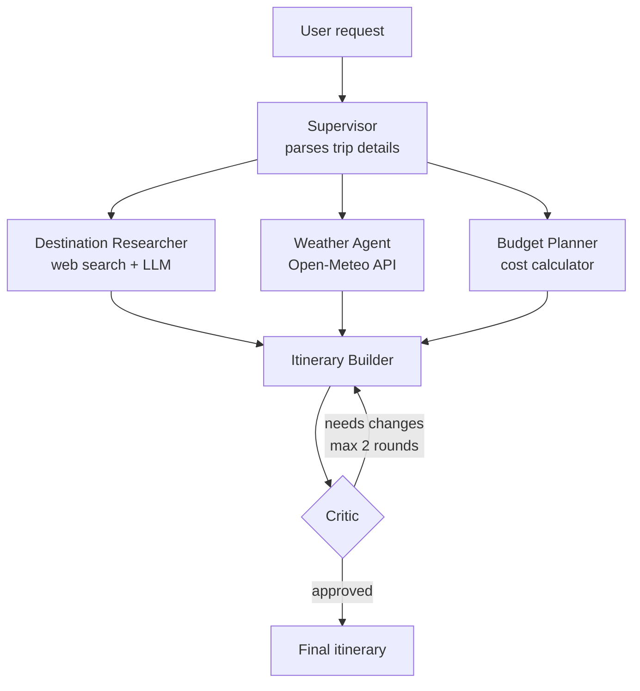

# 🧭 Multi-Agent Travel Planner

A team of specialized AI agents, coordinated with **LangGraph**, that plans a complete trip.
A supervisor parses the request, three agents work **in parallel** (research, weather, budget),
an itinerary builder merges their output, and a **critic** can send the plan back for fixes.

## Architecture



All agents communicate through one shared `TripState` object (`state.py`); each agent reads what
it needs and writes only its own fields.

| Agent | Responsibility | Tools |
|---|---|---|
| Supervisor | Turns free text into structured trip details | LLM |
| Destination Researcher | Attractions, food, hidden gems | DuckDuckGo search + LLM |
| Weather Agent | Forecast and packing advice | Open-Meteo API (no key) |
| Budget Planner | Cost breakdown vs. budget | Deterministic calculator |
| Itinerary Builder | Day-by-day plan from all inputs | LLM |
| Critic | Checks days, timing, weather, budget; requests fixes | Rule checks + LLM |

## Design decisions

- **Parallel fan-out / fan-in:** the three independent agents run concurrently; the builder waits for all of them.
- **Critic loop with a hard cap** (`MAX_CRITIC_ITERATIONS`, default 2) so it can never loop forever.
- **Rules where possible, LLM where needed:** budget math and "all days present" checks are deterministic, so they are reliable and testable.
- **Graceful degradation:** if search or weather fails, the agent returns a fallback and the plan still completes.
- **Provider-agnostic:** Gemini, OpenAI or Anthropic via one env variable.

## Setup

```bash
git clone <your-repo-url>
cd travel-planner-agents
python -m venv .venv && source .venv/bin/activate   # Windows: .venv\Scripts\activate
pip install -r requirements.txt
cp .env.example .env                                  # then add your API key
```

In `.env`, set `LLM_PROVIDER` (`gemini`, `openai` or `anthropic`) and the matching API key.

## Run

```bash
streamlit run app.py                                  # web UI with live agent activity
python main.py "4-day Mussoorie trip from Dehradun, 3 people, Rs 15000, nature and cafes"   # CLI
```

## Test

```bash
pytest
```

Tests stub the LLM, search and weather, so they run offline and verify the graph wiring,
parallel execution, and the critic-loop cap.

## Project structure

```
├── app.py            # Streamlit UI
├── main.py           # CLI
├── graph.py          # LangGraph workflow
├── state.py          # shared TripState
├── llm.py            # provider-agnostic LLM wrapper
├── config.py
├── agents/           # supervisor, researcher, weather, budget, itinerary, critic
├── tools/            # search, weather_api, budget_calc
└── tests/
```

## Limitations and future work

- Budget uses rough per-tier assumptions (`tools/budget_calc.py`), not live prices.
- Weather covers at most 16 days ahead and does not take a custom start date yet.
- Ideas: live hotel/transport APIs, map links, PDF export, user memory across sessions, per-agent evaluation.
